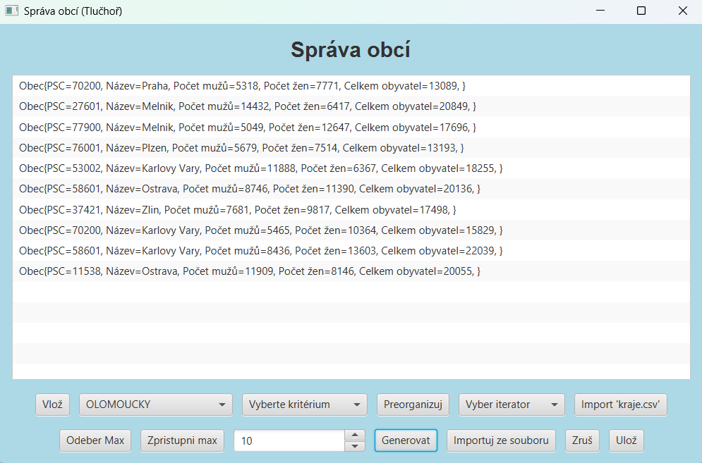

# 🏘️ BDATS – Semestrální práce C

Semestrální práce z předmětu **Datové struktury (BDATS)**, realizovaná v akademickém roce **2024/2025** na Univerzitě Pardubice, Fakultě elektrotechniky a informatiky (FEI).

Projekt je zaměřen na implementaci prioritní fronty obcí pomocí levostranné haldy reprezentované polem.

## 👨‍💻 Autor

**Aleš Tlučhoř**

Univerzita Pardubice – Fakulta elektrotechniky a informatiky (FEI)

## 🛠️ Použité technologie

- ☕ Java
- 📦 Maven
- 🖥️ JavaFX

## ⚙️ Funkcionalita aplikace

Aplikace umožňuje:

- ➕ Vkládání obcí do prioritní fronty.
- 🗑️ Odebrání obce s nejvyšší prioritou (`OdeberMax`).
- 👁️ Zobrazení obce s nejvyšší prioritou (`ZpřístupniMax`).
- 🏗️ Vytvoření prioritní fronty (`Vybuduj`).
- 🔄 Reorganizaci fronty podle zvoleného kritéria.
- 📋 Výpis prvků pomocí iterátoru.
- 🔀 Výběr kritéria priority – počet obyvatel nebo název obce.
- 📂 Import dat ze souboru `kraje.csv`.
- 🎲 Generování náhodných obcí podle zvoleného kraje.
- 💾 Ukládání a rušení prioritní fronty.

## 🖥️ Ukázka aplikace

## 📁 Struktura projektu

- `src/` – zdrojové kódy aplikace
- `kraje.csv` – vstupní data o obcích
- `pom.xml` – konfigurace Maven projektu
- `README.md` – dokumentace projektu

## 🚀 Spuštění projektu

Projekt lze otevřít v IDE s podporou Javy a Maven (např. NetBeans nebo IntelliJ IDEA).

---

📚 **Akademický rok:** 2024/2025

🎓 **Předmět:** Datové struktury (BDATS)

👨‍💻 **Autor:** Aleš Tlučhoř